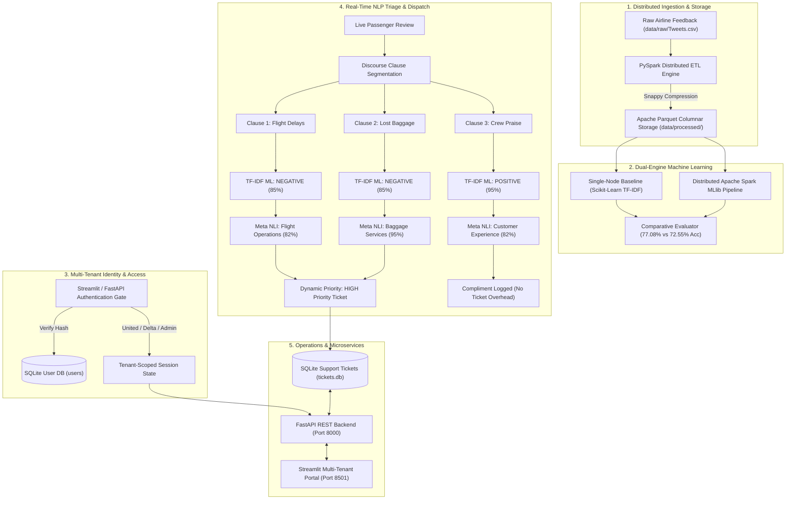
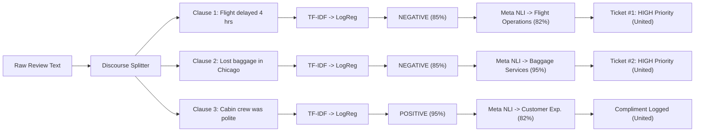

# AirRoute AI Enterprise: Multi-Tenant Airline Passenger Sentiment Analysis & Intelligent Review Routing System

[](https://www.python.org/)
[](https://spark.apache.org/)
[](https://fastapi.tiangolo.com/)
[](https://streamlit.io/)
[](https://scikit-learn.org/)
[](https://docs.pytest.org/)

---

## 1. Executive Platform Overview

**AirRoute AI Enterprise** is a scalable, multi-tenant B2B SaaS platform designed for commercial airlines and aviation operational centers to process, analyze, and dispatch customer feedback in real time.

### Core Value Proposition & Innovations:
1. **Multi-Tenant Airline Data Isolation:** Airlines (*United, Delta, American, Southwest, etc.*) register and sign in with dedicated organizational accounts. Each airline accesses **only their own** sentiment telemetry, complaint categories, passenger reviews, and customer service tickets.
2. **Super Admin Panoramic Telemetry:** System administrators monitor global cross-airline benchmarks, compare Net Sentiment Scores (NSS), and dynamically toggle viewport scopes across tenants.
3. **Discourse Clause Decomposition:** Natural language conjunctions (`and`, `but`, `however`) decompose compound reviews into atomic grammatical sub-clauses, eliminating the blind spots of monolithic whole-review sentiment classifiers.
4. **Dual-Model ML Architecture:** High-throughput batch feature extraction via **Apache PySpark & MLlib** combined with microsecond-latency real-time inference via **Scikit-Learn TF-IDF**.
5. **Meta NLI Zero-Shot Department Routing:** DistilBART Natural Language Inference maps each individual sub-clause to one of 6 airline operational departments with confidence calibration.
6. **Automated Ticket Lifecycle Operations:** Dynamic priority scoring (`URGENT`, `HIGH`, `MEDIUM`, `LOW`) generates actionable support tickets persisted to SQLite via SQLAlchemy, managed through a FastAPI REST backend and Streamlit operations portal.

---

## 2. Multi-Tenant Role-Based Access Control (RBAC)

The platform provides out-of-the-box multi-tenant authentication with SHA-256 salted password hashing:

| Account / Username | Password | Role | Tenant Scope & Permissions |
| :--- | :--- | :--- | :--- |
| **`admin`** | `admin123` | `super_admin` | **Global View:** Panoramic analytics across all airlines, tenant switcher, global ticket operations. |
| **`united`** | `united123` | `airline_admin` | **United Airlines:** Scoped to United's 3,822 reviews, sentiment charts, and United support tickets. |
| **`delta`** | `delta123` | `airline_admin` | **Delta Air Lines:** Scoped to Delta's 2,222 reviews, operational complaints, and Delta support tickets. |
| **`american`** | `american123` | `airline_admin` | **American Airlines:** Scoped to American's 2,759 reviews and American support tickets. |
| **`southwest`** | `southwest123` | `airline_admin` | **Southwest Airlines:** Scoped to Southwest's 2,420 reviews and Southwest support tickets. |
| **New Tenant Signup** | *Custom* | `airline_admin` | **Self-Service Onboarding:** Any new airline (e.g. *Emirates, JetBlue*) can register via the portal. |

---

## 3. End-to-End System Architecture



---

## 4. Step-by-Step Walkthrough with Real Example

Consider the following real-world compound passenger review:

> **Passenger Input:**  
> *"@united My flight was delayed by four hours and you lost my baggage in Chicago, but the cabin crew was very polite and helpful!"*



### Detailed Stage Transformations:

1. **Discourse Segmentation (Clause Splitting):**  
   Regex linguistic rules parse coordinating and contrastive conjunctions (`and`, `but`, `however`, `;`, `,`):
   - `Clause 1`: `"united My flight was delayed by four hours"`
   - `Clause 2`: `"lost my baggage in Chicago"`
   - `Clause 3`: `"the cabin crew was very polite and helpful!"`

2. **Feature Engineering (TF-IDF Vectorization):**  
   Each clause is converted into a **5,000-dimensional sparse numeric vector** using sublinear term frequency ($1 + \log(\text{TF})$) multiplied by inverse document frequency ($\log(N/\text{DF})$) across unigrams and bigrams.

3. **Clause-Level Sentiment Classification:**  
   The vector is evaluated by the trained Multiclass Logistic Regression model with Softmax probability calibration:
   - `Clause 1`: **`NEGATIVE`** ($P=0.852$)
   - `Clause 2`: **`NEGATIVE`** ($P=0.852$)
   - `Clause 3`: **`POSITIVE`** ($P=0.950$)

4. **Meta NLI Zero-Shot Department Classification:**  
   Natural Language Inference (Premise $\rightarrow$ Hypothesis) classifies target operational departments:
   - `Clause 1` $\longrightarrow$ **`Flight Operations`** (Match Confidence: **82.0%**)
   - `Clause 2` $\longrightarrow$ **`Baggage Services`** (Match Confidence: **95.1%**)
   - `Clause 3` $\longrightarrow$ **`Customer Experience`** (Match Confidence: **82.0%**)

5. **Tenant Scoping & Ticket Lifecycle:**  
   - Generated tickets are automatically tagged with `airline="United"`.
   - **Ticket #1:** `[TKT-20261002-XXXX]` $\rightarrow$ Routed to **Flight Operations** (`HIGH`, `Open`)
   - **Ticket #2:** `[TKT-20261002-YYYY]` $\rightarrow$ Routed to **Baggage Services** (`HIGH`, `Open`)
   - **Compliment Log:** Positive feedback is logged for internal recognition without cluttering the support queue.

---

## 5. PySpark Big Data ETL & Storage Optimization

- **ETL Script:** `src/processing/pyspark_etl.py`
- **Transformations:** URL/Mention stripping, HTML entity decoding, null/empty record elimination, label indexing.
- **Storage Footprint:**
  - **Raw CSV Size:** 3.42 MB (14,640 records)
  - **Processed Parquet Size:** 2.07 MB (**39.4% Storage Footprint Reduction**)
  - **Processing Runtime:** 8.63 seconds (including Spark Driver & JVM initialization)

### Cleaned Historical Review Distribution:
| Airline | Historical Reviews | Negative % | Neutral % | Positive % | Net Sentiment Score (NSS) |
| :--- | :--- | :--- | :--- | :--- | :--- |
| **Virgin America** | 504 | 35.9% | 34.0% | 30.1% | **-5.8** |
| **Delta** | 2,222 | 43.0% | 32.5% | 24.5% | **-18.5** |
| **Southwest** | 2,420 | 49.1% | 27.4% | 23.5% | **-25.6** |
| **United** | 3,822 | 68.9% | 18.2% | 12.9% | **-56.0** |
| **American** | 2,759 | 71.0% | 16.8% | 12.2% | **-58.8** |
| **US Airways** | 2,913 | 77.6% | 13.1% | 9.3% | **-68.3** |

---

## 6. Model Evaluation: Single-Node Baseline vs Distributed MLlib

| Metric / Attribute | Scikit-Learn Baseline | Apache Spark MLlib Pipeline |
| :--- | :--- | :--- |
| **Framework & Engine** | Scikit-Learn (v1.7.2) / RAM | Apache Spark MLlib (v3.5.3) / JVM DAG |
| **Feature Extraction** | `TfidfVectorizer` (N-gram 1-2, 5k vocab) | `Tokenizer` $\rightarrow$ `HashingTF` (5k bins) $\rightarrow$ `IDF` |
| **Classifier** | Multiclass Logistic Regression | Distributed Logistic Regression |
| **Accuracy** | **77.08%** | **72.55%** |
| **Weighted Precision** | **0.7608** | **0.7176** |
| **Weighted Recall** | **0.7708** | **0.7255** |
| **Weighted F1-Score** | **0.7531** | **0.7189** |
| **Data Load Time** | 0.1556 s | 3.1127 s |
| **Training Time** | 0.2372 s | 4.4826 s |
| **Inference Latency** | **0.0006 s** (Microsecond response) | 0.5535 s |
| **Total Pipeline Time** | **0.7356 s** | **7.5953 s** |
| **Target Scale** | Low-latency API serving (< 2 GB in RAM) | Enterprise cluster batch scale (> 100 GB to Terabytes) |

---

## 7. Scalability Benchmarks Across Dataset Slices

Empirical runtime and accuracy benchmarks conducted across **10%, 25%, 50%, and 100% slices** (`experiments/scalability_benchmark.py`):

| Data Slice | Records | Framework / Engine | Training Time | Total Latency | Accuracy | Weighted F1 |
| :--- | :--- | :--- | :--- | :--- | :--- | :--- |
| **10%** | 1,464 | Scikit-Learn (Single-Node) | 0.0242 s | **0.0456 s** | 69.28% | 0.6275 |
| **10%** | 1,558 | Apache Spark MLlib | 3.6877 s | **4.9878 s** | 70.30% | 0.6859 |
| **25%** | 3,660 | Scikit-Learn (Single-Node) | 0.1104 s | **0.1657 s** | 74.59% | 0.7063 |
| **25%** | 3,761 | Apache Spark MLlib | 1.1690 s | **1.5522 s** | 68.29% | 0.6691 |
| **50%** | 7,320 | Scikit-Learn (Single-Node) | 0.1482 s | **0.2307 s** | 75.75% | 0.7307 |
| **50%** | 7,455 | Apache Spark MLlib | 1.1996 s | **1.5136 s** | 67.25% | 0.6586 |
| **100%** | 14,640 | Scikit-Learn (Single-Node) | 0.2747 s | **0.4333 s** | 79.06% | 0.7757 |
| **100%** | 14,640 | Apache Spark MLlib | 1.3675 s | **1.7289 s** | 72.55% | 0.7189 |

---

## 8. REST API Endpoints Overview

The FastAPI backend exposes the following microservices:

| Method | Endpoint | Description |
| :--- | :--- | :--- |
| `POST` | `/api/auth/login` | Authenticate airline operator or super administrator |
| `POST` | `/api/auth/register` | Self-service registration for new airline tenants |
| `GET` | `/api/auth/users` | List registered tenant accounts (Admin only) |
| `POST` | `/api/predict` | Real-time sentiment prediction, clause splitting & zero-shot department routing |
| `GET` | `/api/tickets` | Query support tickets with tenant airline, status, priority, and department filtering |
| `PATCH` | `/api/tickets/{ticket_id}` | Update ticket lifecycle state (`Open` $\rightarrow$ `In Progress` $\rightarrow$ `Resolved` $\rightarrow$ `Closed`) |
| `DELETE` | `/api/tickets/{ticket_id}` | Delete a specific support ticket |
| `DELETE` | `/api/tickets` | Purge tickets (optionally filtered by tenant airline) |
| `GET` | `/api/analytics/tickets` | Aggregated ticket metrics (Open, In Progress, Resolved, Urgent counts) |
| `GET` | `/api/models/evaluation` | Fetch model comparison metrics and latency benchmarks |

---

## 9. Project Directory Structure

```text
Passenger Review/
├── data/
│   ├── raw/                       # Original raw dataset (Tweets.csv)
│   ├── processed/                 # Parquet columnar storage (airline_reviews.parquet)
│   └── tickets.db                 # SQLite database for support tickets and users
├── src/
│   ├── ingestion/                 # Windows HADOOP & filesystem configuration
│   ├── processing/                # PySpark ETL and text normalization pipelines
│   ├── models/                    # Scikit-Learn baseline and Spark MLlib training scripts
│   ├── routing/                   # Clause-level sentiment & Meta Zero-Shot router
│   └── tickets/                   # Multi-tenant user auth, ticket schema, and CRUD
├── backend/
│   └── main.py                    # Enterprise FastAPI REST API application
├── frontend/
│   └── app.py                     # Multi-tenant Streamlit operations portal
├── experiments/
│   └── scalability_benchmark.py   # Empirical scalability benchmarks (10% to 100%)
├── models/                        # Serialized model artifacts (.joblib & Spark MLlib)
├── results/                       # Scalability benchmark CSVs, JSONs, and metrics
├── docs/                          # Project Report & Poster documents (.md & .docx)
├── tests/                         # Automated test suite (6 passing unit tests)
├── hadoop/                        # Local Windows winutils.exe and hadoop.dll
├── requirements.txt               # Project Python dependencies
├── .gitignore                     # Git ignore rules
└── README.md                      # Comprehensive project documentation
```

---

## 10. Execution & Quickstart Guide

### Step 1: Run Automated Test Suite
```powershell
pytest tests/
```

### Step 2: Run PySpark ETL Pipeline
```powershell
python -m src.processing.pyspark_etl
```

### Step 3: Train Machine Learning Models
```powershell
python -m src.models.train_baseline
python -m src.models.train_spark
python -m src.models.evaluate
```

### Step 4: Run Scalability Experiments
```powershell
python -m experiments.scalability_benchmark
```

### Step 5: Start FastAPI Backend Service
```powershell
uvicorn backend.main:app --reload --port 8000
```
*API Swagger Documentation:* `http://localhost:8000/docs`

### Step 6: Launch Multi-Tenant Streamlit Web Dashboard
```powershell
streamlit run frontend/app.py
```
*Interactive Web Portal:* `http://localhost:8501`

---

## 11. Demonstration Guide

1. Open `http://localhost:8501`.
2. Sign in as **United Airlines** (`united` / `united123`).
   - Notice the tenant badge: `✈ United Airlines`.
   - The **Executive KPI Dashboard** shows strictly United's 3,822 reviews and complaint Pareto chart.
   - The **Ticket Operations Center** displays only tickets generated for United.
3. Sign out and log in as **Super Admin** (`admin` / `admin123`).
   - Notice the **Super Admin Portal** badge.
   - Use the **Tenant Viewport Scope** dropdown in the sidebar to toggle between **All Airlines** (cross-airline comparative view) or inspect any specific airline tenant.
